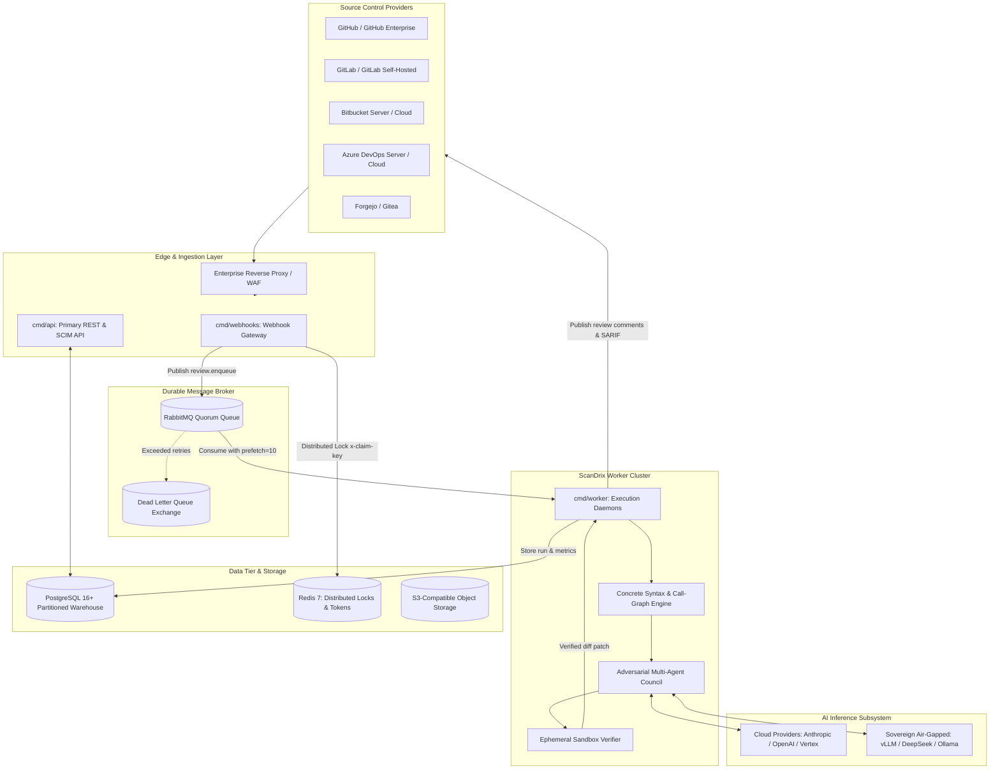
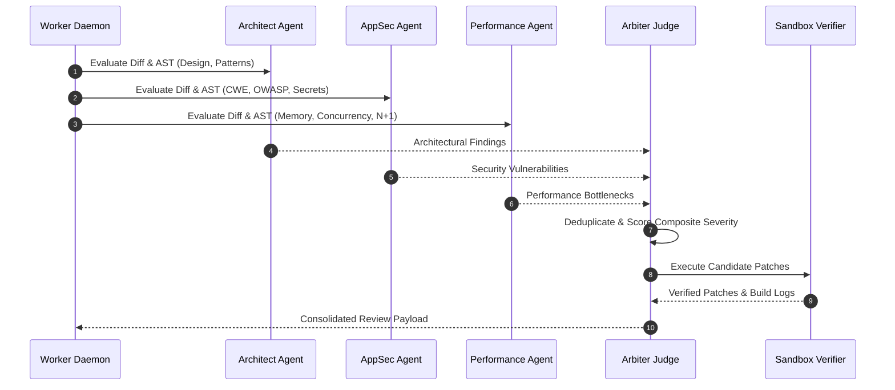

# ScanDrix Enterprise Edition — Technical Requirements Document (TRD)

**Version:** 2.0 Enterprise  
**Status:** Approved Technical Architecture  
**Target Runtime:** Go 1.22+ / Linux amd64 & arm64  
**Product:** ScanDrix AI Enterprise Platform Architecture  
**Author:** ScanDrix Engineering Architecture  

---

## 1. System Architecture & Topology

ScanDrix Enterprise is composed of decoupled, horizontally scalable Go services communicating asynchronously over **RabbitMQ Quorum Queues** with state persistence in **PostgreSQL 16+ (pgxpool)** and ephemeral distributed caching in **Redis 7+**.



---

## 2. Core Go Technical Stack

| Subsystem | Technology | Architectural Specification |
| :--- | :--- | :--- |
| **Language & Runtime** | Go 1.22+ | Single static executable binaries compiled with `CGO_ENABLED=0`, concurrent goroutines, lightweight memory footprint. |
| **HTTP Routing** | `go-chi/chi/v5` | Lightweight, idiomatic `net/http` router with composable security, rate-limiting, and context middleware. |
| **Database Access** | `jackc/pgx/v5` (pgxpool) | High-performance PostgreSQL driver with connection pooling, statement caching, and native binary protocol. |
| **Message Broker** | `rabbitmq/amqp091-go` | Replicated quorum queues, persistent message delivery, and exponential backoff retry mechanisms via dead-letter exchanges. |
| **AST Analysis** | Pure-Go Syntax Parsers | In-memory symbol resolution and concrete syntax analysis across Go, Python, TypeScript, Rust, Java, and C/C++. |
| **Cryptographic Engine** | `golang.org/x/crypto/ed25519` | Offline asymmetric license verification and AES-256-GCM for tenant key encryption. |
| **Verification Sandbox** | Ephemeral Micro-Containers | Rootless Docker / MicroVM isolation running native project build and test commands. |

---

## 3. Subsystem Specifications

### 3.1 Multi-Agent Deliberation Council

The Deliberation Council executes specialized review agents in parallel on the diff and syntax tree:



1. **Architect Agent:** Evaluates modularity, abstraction fidelity, API design consistency, and clean code principles.
2. **AppSec Red-Team Agent:** Scans for CWE classifications, injection flaws, missing authentication guards, secret leaks, and insecure dependencies.
3. **Performance Agent:** Inspects resource lifecycle management, unbuffered channel locks, memory retention, and quadratic algorithmic patterns.
4. **Arbiter Judge:** Normalizes findings, discards duplicate issues raised across multiple domains, and produces the final actionable review payload.

### 3.2 Ephemeral Sandbox Verification

1. **Isolation Boundary:**
   - Sandboxes run inside ephemeral rootless containers with no host file-system mounts.
   - Network egress is blocked or restricted to authenticated private artifact mirrors.
2. **Verification Protocol:**
   - Apply candidate patch to target branch commit.
   - Execute linter and compilation step (`go test -c`, `cargo check`, `npm run build`).
   - If build succeeds, mark finding `VERIFIED_WORKING`.
   - If build fails, feedback compiler errors into the self-correction cycle (max 2 attempts).

### 3.3 Call-Graph & Downstream Impact Engine

1. **Symbol Extraction:** Identifies exported declarations modified by the pull request.
2. **Dependency Resolution:** Traverses repository AST indices to locate call sites across unchanged files.
3. **Change Risk Scoring:** Annotates pull request summaries with potential breaking changes and lists affected downstream caller modules.

### 3.4 Cryptographic Licensing & Entitlements

1. **Offline Asymmetric Verification:**
   - License tokens are issued using Ed25519 private keys and verified using embedded public keys.
   - Zero outbound phone-home network requests required.
2. **Entitlement Envelope Schema:**
   ```json
   {
     "license_id": "uuid",
     "customer_name": "Acme Corp",
     "tier": "enterprise",
     "expires_at": "2027-01-01T00:00:00Z",
     "max_seats": 500,
     "max_repositories": 100,
     "features": [
       "FEATURE_BYOK_ENCRYPTION",
       "FEATURE_AIR_GAPPED",
       "FEATURE_MULTI_AGENT_DELIBERATION",
       "FEATURE_DORA_METRICS"
     ]
   }
   ```
3. **Grace Period & Key Ring:** 7-day grace window on license expiration with zero-downtime key rotation ring support.

### 3.5 High-Throughput Ingestion & Queue Delivery

1. **Webhook Ingestion:**
   - Incoming payloads from GitHub, GitLab, Bitbucket, Azure DevOps, or Forgejo are validated via HMAC SHA-256.
   - Idempotency key generated as `hash(repo_id + pr_number + head_sha)`.
   - Redis distributed lock prevents concurrent processing of the same commit revision.
2. **Queue Topology:**
   - `scandrix.review.jobs` (Quorum Queue, persistent messages, prefetch=10).
   - `scandrix.review.dlq` (Dead Letter Queue with exponential retry policy).

---

## 4. Database Architecture & Row-Level Security

1. **Row-Level Security (RLS):**
   - Every tenant table enforces PostgreSQL Row-Level Security:
     ```sql
     ALTER TABLE pull_requests ENABLE ROW LEVEL SECURITY;
     CREATE POLICY tenant_isolation_policy ON pull_requests
         USING (workspace_id = current_setting('app.current_tenant_id')::uuid);
     ```
2. **Time-Partitioned Analytics:**
   - DORA metrics and audit event tables are partitioned monthly by timestamp, ensuring sub-100ms analytics queries across millions of review runs.
